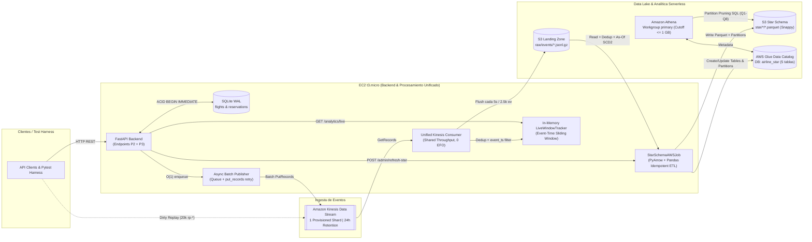

# Tercer Parcial — Airline Reservation System: Events, Live View & Star Schema

## Documento de Arquitectura, Decisiones de Diseño (Sección 5), Costos y Defensa Oral

---

## 1. Diagrama de Arquitectura Desplegada



---

## 2. Decisiones de Diseño y Justificación (Sección 5)

### 5.1 ¿Qué va al stream y qué no? ( Búsquedas vs. Reservas y Patrón Outbox )
* **Requisitos vinculados:** **R1, R2** | **Pilares Well-Architected:** *Performance Efficiency*, *Reliability*, *Security*.
* **Justificación:** Las búsquedas (`search_performed`) son telemetría de comportamiento de muy alta frecuencia y lectura pura (relación ~6.5:1 frente a reservas en el replay). Bloquear al usuario esperando red hacia Kinesis degradaría la experiencia y violaría el umbral `p95 <= 1.0 s` bajo ráfagas de 50 hilos (**R2**); en términos de negocio, perder una búsqueda aislada ante una caída catastrófica del nodo apenas altera una métrica agregada en centésimas porcentuales. Por el contrario, `reservation_created` y `reservation_cancelled` representan **transacciones financieras y de inventario de sillas**: son menos frecuentes pero críticas para conciliación de ingresos netos (**Q1, Q4, Q5**) y tasas de cancelación (**Q2**), por lo que nunca deben omitirse ni emitirse antes del `COMMIT` en base de datos, y jamás incluyen PII (`passenger_name` excluido por diseño). En nuestro backend, una cola en memoria con *worker* por lotes (`put_records` hasta 500 registros con reintentos exponenciales selectivos sobre `FailedRecordCount > 0`) desacopla la latencia HTTP (< 30 ms) garantizando 0 pérdidas en ráfaga (**R2**).
* **Solución en producción para cero pérdida entre BD y Kinesis (Dual-Write Problem):** Implementaríamos el **Transactional Outbox Pattern**: dentro de la misma transacción ACID que inserta/cancela en `reservations`, se inserta el evento serializado (con su `event_id` único) en una tabla local `outbox_events`. Un proceso *relay* asíncrono lee filas pendientes de `outbox_events`, las publica en Kinesis y las marca como enviadas (*at-least-once delivery*), apoyándose en la deduplicación aguas abajo por `event_id`.

### 5.2 Dos caminos: Fast Path (Segundos) vs. Analytical Path (Minutos)
* **Requisitos vinculados:** **R3, R5, R8, R10, R12** | **Pilares Well-Architected:** *Performance Efficiency*, *Cost Optimization*.
* **Justificación:** `GET /analytics/live` necesita latencia sub-10 segundos (**R3**) sobre una ventana móvil de 5 minutos filtrada por `event_ts`. Leer directamente el stream de Kinesis hacia una estructura en memoria (`LiveWindowTracker`) responde en `< 2 ms` a costo marginal `$0`. Si la vista en vivo consultara **Athena**, cada petición pagaría la latencia de arranque del motor distribuido Trino (1–4 s), dependería del retraso de entrega a S3 y escaneo de catálogo, y facturaría un mínimo de 10 MB por consulta (`$5/TB`): apenas 1 consulta cada 2 segundos generaría ~1.3 millones de consultas/mes (> `$65 USD/mes`), rompiendo el presupuesto (**R12**).
* **Por qué el esquema estrella se refresca por micro-lotes y qué se rompería evento por evento:** Un esquema estrella en S3/Parquet está optimizado para lecturas columnares masivas, compresión por diccionarios/RLE e inmutabilidad. Si intentáramos actualizar Parquet **por cada evento individual**, provocaríamos el *Small Files Problem*: decenas de miles de archivos Parquet de pocos KB en S3 dispararían costos de peticiones `PUT`/`LIST`, anularían la compresión columnar, degradarían las consultas de Athena por *overhead* de apertura de objetos S3 y generarían condiciones de carrera en lectores concurrentes al no existir transacciones ACID nativas sobre tablas Hive/Parquet crudas.

### 5.3 Zona de Aterrizaje en S3 (Landing Zone): Entrega Administrada vs. Consumidor Propio
* **Requisitos vinculados:** **R4, R11, R12** | **Pilares Well-Architected:** *Cost Optimization*, *Operational Excellence*, *Reliability*.
* **Justificación:** Elegimos un **consumidor propio unificado** (`KinesisStreamConsumer` + `S3LandingFlusher`) que lee el único shard con *shared throughput* (sin Enhanced Fan-Out, cumpliendo **R11**) y alimenta en una sola pasada tanto `LiveWindowTracker` como el *buffer* hacia S3, escribiendo lotes *append-only* `.jsonl.gz` cada `5 s` o `2,500` eventos.
* **Costo en latencia y dinero frente a Amazon Data Firehose:**
  * **Latencia:** Firehose impone un intervalo mínimo de *buffering* de `60 s` (1–2 min típicos); nuestro *flusher* deposita los ~20,900 eventos del replay en S3 en **~10–15 s** (muy por debajo de los `300 s` de **R4**).
  * **Dinero y operación:** Firehose cobra `$0.029/GB` ingerido (más conversión opcional), consume cuota adicional de `GetRecords` sobre el único shard (límite estricto de 5 lecturas/s en **R11**, compartido con el propio harness) y en **AWS Academy Learner Lab** suele fallar al crear roles IAM dedicados. Nuestro consumidor unificado cuesta **`$0.00` adicionales**, usa `LabInstanceProfile` directamente y reduce la compresión en S3 ~80 % mediante `gzip`.

### 5.4 Diseño del Esquema Estrella, Grano, Dimensiones Conformadas y Matriz de Bus
* **Requisitos vinculados:** **R5, R6, R7, R9, R10** | **Pilares Well-Architected:** *Performance Efficiency*, *Reliability* (integridad de datos).

#### Diagrama Entidad-Relación del Esquema Estrella (`airline_star`)

```mermaid
erDiagram
    dim_date ||--o{ fact_search : "date_key"
    dim_route ||--o{ fact_search : "route_key (as-of)"
    dim_date ||--o{ fact_booking_event : "date_key"
    dim_route ||--o{ fact_booking_event : "route_key (as-of)"
    dim_fare_class ||--o{ fact_booking_event : "fare_class_key"

    dim_date {
        int date_key PK "YYYYMMDD (2023..2027)"
        date full_date
        int year
        int month
        int quarter
        int weekday "1=Mon..7=Sun"
        string weekday_name
        boolean is_weekend
        boolean is_holiday
        string holiday_name
        boolean is_long_weekend
        string month_name "Extra hierarchy"
        int day_of_month "Extra hierarchy"
        string year_month "Extra YYYY-MM"
    }

    dim_route {
        int route_key PK "Surrogate SCD2"
        string route NK "AAA-BBB"
        string origin
        string destination
        string region
        string route_category "REGIONAL | TRUNK"
        date valid_from "Inclusive"
        date valid_to "Exclusive (9999-12-31)"
        boolean is_current
        string destination_region "Extra"
        boolean is_trunk "Extra"
    }

    dim_fare_class {
        int fare_class_key PK
        string fare_class "ECONOMY | BUSINESS"
        string cabin_group "Extra"
        double price_multiplier "Extra"
    }

    fact_search {
        string event_id PK
        int date_key FK
        int route_key FK
        int results_count
        int searches "= 1"
        string month "PARTITION KEY (YYYY-MM)"
    }

    fact_booking_event {
        string event_id PK
        int date_key FK
        int route_key FK
        int fare_class_key FK
        string reservation_id "Degenerate dim"
        string event_type
        int bookings "1 or 0"
        int cancellations "0 or 1"
        bigint revenue_cents "+price or -price"
    }
```

#### Declaración de Grano y Dimensiones Conformadas
1. **`fact_search` (Grano):** Exactamente **una fila por evento único de búsqueda (`search_performed`)** deduplicado por `event_id`, asignado a la fecha UTC en que ocurrió (`event_ts`) y particionado físicamente por `month` (`YYYY-MM`).
2. **`fact_booking_event` (Grano):** Exactamente **una fila por evento único transaccional de reserva (`reservation_created` o `reservation_cancelled`)** deduplicado por `event_id`, con medidas aditivas con signo (`bookings`, `cancellations`, `revenue_cents = +price_cents` al crear y `-price_cents` al cancelar) e incluyendo `reservation_id` como *dimensión degenerada*.
3. **Dimensiones conformadas (compartidas):** **`dim_date`** y **`dim_route`** son dimensiones 100 % conformadas entre `fact_search` y `fact_booking_event`. Esto permite realizar *drill-across* seguro (consultas separadas por tabla de hechos unidas por los atributos conformados de ruta o festivo en **Q6** y **Q7**) evitando *fan traps* o productos cartesianos entre búsquedas y reservas.
4. **Atributos adicionales agregados más allá del contrato y por qué:**
   * En **`dim_date`**: `month_name` (`January..December`), `day_of_month` (`1..31`) y `year_month` (`YYYY-MM`) para soportar jerarquías naturales (`year -> quarter -> month_name -> full_date`) en herramientas BI sin funciones de formateo en SQL.
   * En **`dim_route`**: `destination_region` (región del aeropuerto destino, complementando `region` del origen) e `is_trunk` (`boolean`), facilitando análisis de tráfico inter-regional vs. intra-regional y filtrado booleano directo de rutas troncales.
   * En **`dim_fare_class`**: `cabin_group` (`MAIN_CABIN` / `PREMIUM_CABIN`) y `price_multiplier` (`1.0` / `2.2`) para documentar la regla tarifaria directamente en el modelo dimensional.

#### Trazabilidad de Preguntas de Negocio (Q1–Q8) y Matriz de Bus (Kimball Bus Matrix)

| Pregunta | Tabla(s) de Hechos | Medida(s) Usada(s) | `dim_date` | `dim_route` (SCD2) | `dim_fare_class` |
|---|---:|---|:---:|:---:|:---:|
| **Q1:** Ingreso neto por mes y clase tarifaria | `fact_booking_event` | `SUM(revenue_cents)` | **X** (`year, month`) | | **X** (`fare_class`) |
| **Q2:** Reservas, cancelaciones y tasa por ruta | `fact_booking_event` | `SUM(bookings), SUM(cancellations)` | | **X** (`route`) | |
| **Q3:** Reservas por nombre del día de semana | `fact_booking_event` | `SUM(bookings)` | **X** (`weekday_name`) | | |
| **Q4:** Top 10 rutas por ingreso neto | `fact_booking_event` | `SUM(revenue_cents)` | | **X** (`route`) | |
| **Q5:** Ingreso neto mensual por categoría vigente el día del evento | `fact_booking_event` | `SUM(revenue_cents)` | **X** (`year, month`) | **X** (`route_category` as-of) | |
| **Q6:** Búsquedas vs. reservas (conversión) por ruta | `fact_search` + `fact_booking_event` | `COUNT(*) / SUM(searches)` y `SUM(bookings)` | | **X** (`route` conformada) | |
| **Q7:** Búsquedas y reservas en festivos vs. días ordinarios | `fact_search` + `fact_booking_event` | `COUNT(*)` y `SUM(bookings)` | **X** (`is_holiday` conformada) | | |
| **Q8:** Reservas en puentes festivos (*long weekends*) vs. resto | `fact_booking_event` | `SUM(bookings)` | **X** (`is_long_weekend`) | | |

### 5.5 Selección del Proceso ETL: Comparativa Técnica y Económica
* **Requisitos vinculados:** **R5, R6, R8, R10, R12** | **Pilares Well-Architected:** *Cost Optimization*, *Operational Excellence*, *Performance Efficiency*.

| Criterio | 1. Worker Python + PyArrow en EC2 *(Elegida)* | 2. Athena `CTAS` / `INSERT INTO` | 3. AWS Lambda (Pandas / DuckDB) | 4. AWS Glue Job / EMR Serverless |
|---|---|---|---|---|
| **Costo por corrida / mensual** | **`$0.00` extra** (usa CPU ociosa de la EC2 `t3.micro` ya pagada: `$7.59/mes`) | ~$0.01/corrida (mín. 10 MB * N tablas = ~$0.50–$1.50/mes) | ~$0.001/corrida (< $0.20/mes en capa gratuita/bajo uso) | `$0.44/DPU-hora` (mín. 2 DPU * 1 min/corrida -> `$3–$12/mes`) |
| **Arranque + ejecución vs. límite 15 min (R8)** | **0 s cold-start; ~4–8 s total** para 20k eventos (100x bajo el límite de 900 s) | ~15–35 s (5 queries secuenciales DDL/CTAS + reparación de particiones) | 2–6 s cold-start + ~6–10 s ejecución (riesgo de límite 15 min si crece) | 45–180 s de aprovisionamiento + ejecución (~2–5 min; alto riesgo en Learner Lab) |
| **Escalabilidad en volumen** | Hasta ~1–2 millones de eventos por lote en 1 GiB RAM (+ 1 GiB swap) | Muy alta (motor distribuido MPP sin servidor) | Limitada por 10 GB RAM y *timeout* duro de 15 min | Masiva (decenas de TB / cientos de millones de filas) |
| **Simplicidad operativa (Learner Lab)** | **Máxima**: mismo repositorio, cero roles IAM extra, control exacto de tipos Parquet (`date32`) | Media: requiere borrar prefijos S3 por fuera porque `CTAS` falla si el prefijo S3 no está vacío | Media: empaquetar capas binarias `pyarrow`/`duckdb` y permisos IAM Lambda | Baja: requiere roles IAM Glue/EMR frecuentemente restringidos en Learner Lab |
| **Idempotencia** | **Total**: deduplica por `event_id`, limpia prefijo S3 de destino, escribe Parquet Snappy y reemplaza particiones Glue | Requiere orquestador externo que borre S3 + `DROP TABLE` antes de cada `CTAS` | Igual que Python en EC2, pero requiere coordinación de estado para `/admin/refresh-status` | Requiere *Job Bookmarks* o sobrescritura explícita de particiones |

* **Justificación cuantitativa y cuándo cambiaríamos la decisión:** Con el volumen proyectado (50k búsquedas/día -> ~1.5M eventos/mes ≈ ~35 MB comprimidos en S3), el *worker* PyArrow en la misma EC2 `t3.micro` ejecuta el refresco completo en **< 10 segundos** con **`$0.00` de sobrecosto mensual** (manteniendo la proyección total en **`$11.34 USD/mes`**, muy por debajo del tope de `$50 USD` de **R12**). Migraríamos esta decisión a **Athena Incremental / Apache Iceberg (`MERGE INTO`)** o **AWS Glue Spark** cuando el volumen supere **2–5 millones de eventos activos por ventana de refresco** (> 300–500 MB en memoria), donde el procesamiento en un solo nodo saturaría la memoria de `t3.micro`.

### 5.6 Dimensiones Lentamente Cambiantes (SCD Tipo 2 en `dim_route`)
* **Requisitos vinculados:** **R8, R9** | **Pilares Well-Architected:** *Reliability* (exactitud histórica).
* **Por qué SCD Tipo 2 y qué respondería mal Tipo 1:** El `2025-02-01` al menos un tercio de las rutas cambian su atributo `route_category` entre `REGIONAL` y `TRUNK`. Una dimensión **SCD Tipo 1** sobrescribiría la fila de la ruta con la nueva categoría, haciendo que todas las reservas de **enero de 2025** se sumen erróneamente bajo la categoría de febrero en **Q5** (reescribiendo la historia financiera). Con **SCD Tipo 2**, cada versión recibe su propio `route_key` subrogado y rango `[valid_from, valid_to)` (`valid_to = 9999-12-31`, `is_current = true` para la vigente).
* **Resolución para eventos tardíos (*late events*):** El ETL extrae `event_date = DATE(event_ts)` (cuando ocurrió el hecho en el mundo real, nunca cuando llegó a Kinesis/S3) y ejecuta un ***as-of join*** (`r.route = e.route AND r.valid_from <= event_date AND event_date < r.valid_to`). Así, una reserva del `2025-01-20` que llegue retrasada en marzo recibe determinísticamente el `route_key` vigente en enero.

### 5.7 Manejo de Eventos Sucios (Duplicados, Tardíos y Fuera de Orden)
* **Requisitos vinculados:** **R3, R6, R8, R9** | **Pilares Well-Architected:** *Reliability*.
* **Duplicados (3 %):** En la ruta rápida (`LiveWindowTracker`), un conjunto acotado `seen_ids` descarta en $O(1)$ cualquier `event_id` ya contabilizado. En la ruta analítica (`transform_events_to_star`), todos los eventos leídos del *landing zone* se ordenan determinísticamente por `(event_ts, event_id)` y se deduplican por `event_id`, garantizando grano 1:1 (`COUNT(*) == COUNT(DISTINCT event_id)`, **R6/R8**).
* **Tardíos (2 %) y Fuera de Orden (1 %):** Ningún componente usa el *arrival timestamp* de Kinesis ni de S3 para lógica de negocio. En la vista en vivo, la ventana deslizante evalúa `now - window <= event_ts <= now`, descartando inmediatamente eventos históricos del replay (`2025-*`, **R3**). En el ETL analítico, al reconstruir particiones mensuales completas por `month = SUBSTR(event_ts, 1, 7)` y asignar `date_key` + SCD2 `route_key` según `event_ts`, el resultado final es matemáticamente idéntico sin importar el desorden o retraso de llegada (**R8**).

### 5.8 Costos, Ciclo de Vida de Recursos y Sostenibilidad
* **Requisitos vinculados:** **R10, R11, R12** | **Pilares Well-Architected:** *Cost Optimization*, *Sustainability*.
* **Ciclo de vida (Recursos permanentes vs. efímeros de prueba):**
  * *Sólo durante pruebas (`scripts/aws_up.py` / `scripts/aws_down.py`):* **Kinesis Data Stream** (1 shard aprovisionado cobra `$0.015/hora` exista tráfico o no; crearlo al iniciar pruebas y eliminarlo al terminar reduce el gasto mensual de `$10.95` a `~$3.00` por ~200 h/mes y protege los `$50` del Learner Lab). La instancia **EC2 `t3.small`** también puede detenerse (*Stop Instance*) fuera de horario de trabajo.
  * *Permanentes de costo casi nulo:* **S3** (`$0.023/GB-mes`), **Glue Data Catalog** (`$0.00` bajo 1M de objetos) y **Athena** (pago exclusivo por TB escaneado, protegido con `BytesScannedCutoffPerQuery = 900 MB <= 1 GB` en el workgroup `primary`, **R10**).

#### Tabla de Justificación de Servicios y Proyección Mensual (`cost_projection.yaml`)

| Servicio AWS | Rol en la Arquitectura | Dimensionamiento Mínimo | Costo Mensual Estimado (USD) |
|---|---|---|---:|
| **Amazon Kinesis Data Streams** | Bus de eventos desacoplado (R1–R4, R11) | 1 shard `PROVISIONED`, retención 24h, 0 EFO (~200 h activas/mes) | `$3.00` |
| **Amazon EC2** | API FastAPI + SQLite WAL + Consumer + ETL PyArrow | 1x `t3.micro` (`$0.0104/h * 730 h`; consolida BD, API y ETL en 1 nodo) | `$7.59` |
| **Amazon S3** | Landing zone `.jsonl.gz`, Parquet Star Schema y resultados Athena | ~5 GB Standard + solicitudes PUT/GET | `$0.25` |
| **Amazon Athena** | Motor SQL serverless sobre Parquet particionado (R7, R9, R10) | ~20 GB escaneados/mes (`$5.00/TB`, límite 900 MB/query) | `$0.50` |
| **AWS Glue Data Catalog** | Metastore de las 5 tablas y particiones `month` (R5) | 5 tablas + < 100 particiones (Free Tier < 1M objetos) | `$0.00` |
| **Total Proyectado** | *(Calculado automáticamente por el harness desde `line_items`)* | **77 % por debajo del techo de `$50.00` (R12)** | **`$11.34`** |

* **Conexión con Sostenibilidad:** Consolidar API, base transaccional ligera (SQLite WAL), consumidor de streaming y ETL columnar (PyArrow) en una sola instancia `t3.micro`, comprimir la zona cruda con `gzip` y almacenar el modelo dimensional en **Parquet Snappy particionado por mes** minimiza horas-servidor ociosas, transferencia de red y bytes leídos por consulta en Athena (**R10**: escanear un mes lee ~33 % de los bytes totales, reduciendo cómputo compartido por consulta).

---

## 3. Consideraciones del Entorno AWS Academy Learner Lab (Sección 6)
1. **IP Pública Dinámica de EC2:** Cada vez que el Learner Lab se reinicia, la IP pública de EC2 cambia. Antes de ejecutar `pytest`, actualiza `backend.base_url` en `parcial3-harness-estudiantes/config.yaml`.
2. **Permisos IAM (`LabRole` / `LabInstanceProfile`):** Al asociar `LabInstanceProfile` a la instancia EC2, el backend hereda credenciales temporales rotativas automáticamente para Kinesis, S3, Glue y Athena **sin copiar llaves en el servidor**. Algunas sondas opcionales de facturación en el harness (`rds`, `elasticache`, `eks`) pueden aparecer como *unknown* si el rol de estudiante restringe `Describe*` globales; el harness las maneja sin penalizar R1–R12.

---

## 4. Guía Rápida para la Defensa Oral Eliminatoria (Sección 8)

> [!IMPORTANT]
> En la sustentación oral el profesor puede pedir cambios en vivo por bloque (**R1–R4**, **R5–R10**, **R11–R12**). Aquí está el mapa exacto de impacto en el código:

1. **Bloque R1–R4 (Eventos y Live View) — *"Agreguen un campo nuevo al evento o cambien la ventana / métrica de `/analytics/live`"***:
   * Construcción del evento y llave de partición: `backend/events.py` (`build_search_performed`, `build_reservation_event`).
   * Conteo por `event_ts` y deduplicación en memoria: `backend/consumer.py` (`LiveWindowTracker.ingest` y `LiveWindowTracker.snapshot`).
   * Micro-batching hacia S3: `backend/consumer.py` (`S3LandingFlusher`).
2. **Bloque R5–R10 (Star Schema y ETL) — *"Agreguen una medida a `fact_booking_event` (ej. `gross_revenue_cents`) o un atributo nuevo a `dim_route` / `dim_date`"***:
   * Esquema PyArrow + cálculo de la columna/medida: `etl/star_builder.py` (`build_dim_date_table`, `dim_route_to_table`, `transform_events_to_star`).
   * **Registro automático en Glue:** `_glue_columns_from_schema(tbl.schema)` en `etl/star_builder.py` deriva automáticamente las columnas Glue desde el `pa.Schema` de PyArrow, por lo que basta con agregar el campo al `pa.schema([...])` y disparar `POST /admin/refresh-star` para actualizar S3 Parquet + Glue Data Catalog sin escribir DDL manual.
   * Prueba local inmediata: `python scripts/local_smoke_test.py --seed <SEED>`.
3. **Bloque R11–R12 (Costos y Stream Mínimo) — *"¿Por qué modo Provisioned de 1 shard cuesta menos aquí que On-Demand?"***:
   * Kinesis *On-Demand* tiene un cargo base mínimo de `$0.04/hora` (`~$29.20/mes` fijo + ingesta por GB), mientras que **1 shard Provisioned** cuesta `$0.015/hora` (`$10.95/mes` 24/7 o `$3.00/mes` prendiéndolo solo en pruebas con `scripts/aws_up.py` / `scripts/aws_down.py`) y soporta `1,000 registros/s` (`1 MB/s`), capacidad de sobra para la ráfaga R2 de 200 búsquedas.
